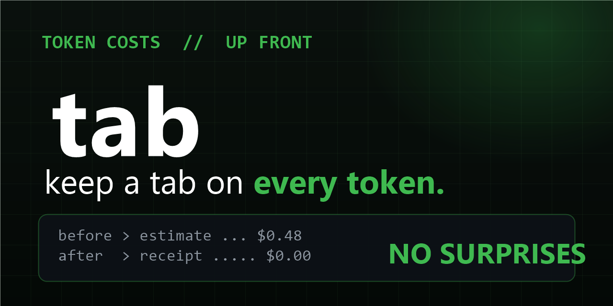

# Tab — keep a tab on every token



[](LICENSE)
[](https://github.com/lastknownstar-bot/tab/stargazers)
[](https://github.com/lastknownstar-bot/tab/commits/master)

**See the price *before* you approve.** Pre-flight cost estimates plus per-session receipts for coding agents. Because "this prompt will cost ~$X" should be visible, not a surprise.

```
$ node bin/tab.mjs price openrouter/anthropic/claude-sonnet-4 120000 8000
openrouter/anthropic/claude-sonnet-4 — in=120000 out=8000 → $0.3840 (live OpenRouter pricing)

$ opencode export ses_abc123 --sanitize > s.json
$ node bin/tab.mjs audit s.json
session ses_abc123 — opencode/big-pickle (agent: build)
tokens: input=108 cache-read=42106 output=72 reasoning=70
cost: $0.00 (Zen free model (assumed $0))
```

## The 30-second version

- **`price`** — estimate any run before it happens, from live OpenRouter pricing (no key needed). Free tiers (`:free`, Pollinations, Zen big-pickle) price at $0.
- **`audit`** — feed it `opencode export --sanitize` JSON, get an itemized receipt: input / cache-read / output / reasoning tokens + cost.
- **`SKILL.md`** — agent discipline: estimate before big runs, announce cost before paid models, auto-downgrade rules.

## Install

Zero dependencies, Node 18+. Nothing to install:

```bash
git clone https://github.com/lastknownstar-bot/tab.git
cd tab
node bin/tab.mjs price openrouter/qwen/qwen3.8-27b:free 50000 5000
```

## Why this exists

Cost anxiety is the #1 emotion in the agent-coding ecosystem: sessions burn $2–10 with zero visibility, half of it on work free models could do. Tab makes spend legible — estimate up front, receipt after — and pairs with [freeload](https://github.com/lastknownstar-bot/freeload) (route to free) so the receipt keeps reading $0.00.

## Pricing notes (honest)

- OpenRouter rates are fetched live — always current.
- Reasoning tokens are billed at output rates, cache reads at input rates (provider conventions; actual billing may vary slightly).
- Models outside OpenRouter + the known-free list report tokens with cost UNKNOWN rather than a made-up number.

## License

MIT — see [LICENSE](LICENSE).
